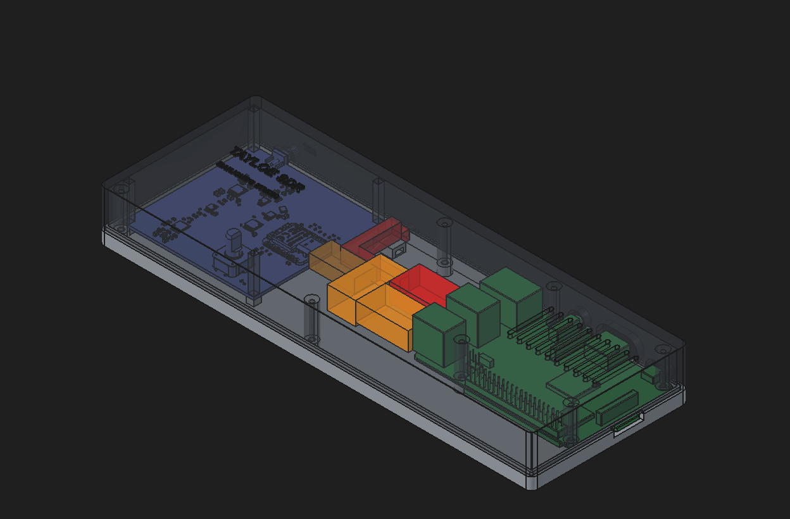

# meche: 3D-printed enclosure

## Goal

One printed box that holds the Tayloe SDR receiver board and a Raspberry Pi 3 B+ side by side, so the radio and the
Pi that runs it (GNU Radio, the WebSDR) sit together as a single unit:

- the radio's USB-C goes straight across to the Pi on a short cable inside the box
- the outside connections (the radio's SMA antenna port, the Pi's power, HDMI, audio and SD card) come out through the walls
- the antenna's bias-T is powered from the Pi, its cable coming in through the back wall
- vent slots over the Pi's SoC
- the box must fit a 220 x 220 mm print bed

The next revision should be waterproof: a gasket at the base/lid joint, a sealed bulkhead SMA, cable glands instead of
the open port cut-outs, and a breathable vent membrane (see the TODO in `code/CLAUDE.md`).

## How it's built: FreeCAD MCP

The enclosure is built in FreeCAD through the **FreeCAD MCP** server: Claude Code drives FreeCAD through the MCP to
load the board models, model the base and lid around them, check the fit, colour the parts, make the lid see-through
and take screenshots like the one above.

The boards come in as STEP files: the radio from `../radio-project/radio-project.step` (exported from KiCad, so
re-export it when the board changes) and the Pi from `rpi-step/pi3bplus.step`.

Drive FreeCAD only through the MCP: `freecadcmd` saves no colours or visibility.

The current build is 230 x 84 x 27 mm, which is still too long for the 220 mm bed.
